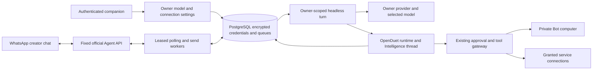

# Saathi implementation and setup

Status: implementation preview, not a production release. The fork is based on
CopilotKit/OpenDuet commit `677e0fcd148d80b99dd788c6d6f9c1c9f40a72db`.

## What this implements

- Official WhatsApp **Agent Platform** transport with creator pairing, encrypted
  tokens, durable poll cursors, duplicate detection, and an ordered send outbox.
- One private built-in Saathi Bot and conversation per connected application
  user. The existing OpenDuet headless runner, tool grants, approval gateway,
  conversation persistence, and computer supervisor remain the execution path.
- Owner-scoped encrypted OpenAI and Anthropic keys, model selection, revocation,
  and pinned main-agent model selection for each run. Owner-scoped selection and
  approval helpers resolve the owner's current settings when called. Personal keys never enter global
  environment variables; the runtime has no deployment-key fallback in Saathi mode.
- Authenticated companion settings at `/settings/saathi`. Secrets are write-only
  and are cleared from inputs on submission. Model verification checks provider
  model access, not successful task execution or tool compatibility.
- Text requests; optional incoming voice transcription through the existing
  operator-configured speech service. Replies currently contain text.
- `/help`, `/models`, `/status`, `/model <provider> <model>`, `/stop`,
  `/allow <id>`, `/deny <id>`, `/handled <id>`, and `/answer <id> <reply>`.

Switching models changes future runs. Replacing or revoking a key blocks subsequent
model calls, including later calls within a running turn; an already dispatched
provider request cannot be recalled. Large approval requests require companion
review. `/stop` aborts the current WhatsApp turn and cancels earlier queued WhatsApp
requests; existing approval requests and independently scheduled work remain in
the companion and must be declined or stopped there.

## Access requirements

The official [WhatsApp Agent Platform manual](https://www.whatsapp.com/developer/WhatsApp-Agent-Platform-Developer-Manual.pdf)
describes a limited-rollout personal agent feature. The creator must actually have
WhatsApp **Settings → Agents** and an agent API key. This implementation does not
make the feature available to an ineligible account. An agent communicates with
its creator; it cannot read family groups, other chats, or message arbitrary
recipients. Agent chats are not end-to-end encrypted.

This is a different product from WhatsApp Business Platform. Do not replace it
with a Business API number without separately reviewing that platform's eligibility
and terms for a general-purpose AI assistant.

The pinned OpenDuet runtime also needs a CopilotKit Intelligence project key for
thread persistence and realtime execution. That deployment credential is separate
from a person's LLM key. No generic CopilotKit onboarding scaffold is required.

## Local setup

Use Bun **1.4.3**, Git, Docker with a working Linux-container engine, and Bash
(WSL or Git Bash on Windows). Keep the existing `openbot/bun.lock`.

1. Install dependencies: `bun install --cwd openbot --frozen-lockfile --ignore-scripts`.
2. Copy `.env.saathi.example` to `openbot/.env`. Keep only one real environment
   file; the upstream start script creates a root `.env` link when needed.
3. Set `KEY_ENCRYPTION_KEY` to a unique base64-encoded 32-byte random key. Store a
   protected backup separately from the database. Set `INTELLIGENCE_API_KEY` to
   the deployment's Intelligence project key.
4. Set unique nonempty `COMPUTER_TOKEN` and `SUPERVISOR_TOKEN`. Keep
   `OPENBOT_ONE_COMPUTER_EACH=true` and a dedicated `COMPUTER_NAMESPACE`. Check
   `.env.example` / `openbot/.env.example` and the upstream configuration guide
   for image tags and ports when another OpenDuet install shares this machine.
5. Run `bash scripts/start.sh`. It starts PostgreSQL and the computer supervisor,
   applies migrations, and starts the API, worker, and app. It supplies the local
   `COMPUTER_SUPERVISOR_URL`; a manually started API needs that private address set
   explicitly. Use the upstream start path for the complete stack.
6. Open `http://localhost:3010/settings/saathi`. Save your own provider key and a
   model ID that supports the tools you intend to use. Add the **separate**
   WhatsApp agent key. Send the displayed pairing message in that agent's chat
   within ten minutes. Send `/status`, followed by a simple read-only task.
7. Sign in to external services through the companion's existing secure handover
   and configure tools/grants as required. An LLM key alone does not connect email,
   shopping, booking, calendar, or payment accounts.

For application-only development against already running infrastructure, use
`bun run dev:saathi` from the repository root. Stop the full stack with
`bash scripts/stop.sh`; the upstream script preserves its database and browser
volumes. Never expose `OPENBOT_SINGLE_USER=true` beyond loopback. Hosting requires
real sign-in, HTTPS, private database/computer endpoints, and backups.

## Architecture and recovery

Migration `0068_saathi.sql` adds five tables and the matching Drizzle snapshot.
The cursor and inbound work commit together. Poll leases carry a changing
generation so an expired poll cannot commit even when the same process reacquires
the connection. Send reservations order multipart messages per connection.

An interrupted running task becomes `needs_review`; it is not automatically
replayed. Unknown send outcomes become `unknown` and require human reconciliation.
Only explicit nonacceptance errors (including documented `503 / 131016`) and rate
limits can retry. Outbound pacing reserves at least 5.1 seconds per send; polls
reserve at least 4.1 seconds between requests. Replies over 24,000 characters are
shortened with an explicit companion referral. Incoming media is restricted to
the official host, audio MIME types, and a 10 MB transfer limit.

Disconnect stops new poll commits, runs, and sends and clears the stored token.
Requests already dispatched can finish. Conversations and task history remain
available in the companion. Reconnect replaces the connection and its transport
queues; reconcile uncertain actions before reconnecting.

## Verification and remaining release work

Verified locally:

- 148 focused Saathi and upstream runtime, authorization, and settings tests after
  the dependency patch.
- 166 native PostgreSQL 17/pgvector tests across Saathi persistence/concurrency,
  tenant packages, and channel routes. All migrations applied to a fresh disposable
  database. Three concurrency cases use a pool of four connections to verify
  exclusive poll leases, serialized conversation turns, contiguous multipart
  replies, and exclusive send reservations.
- Workspace TypeScript checks, production app build, and browser interaction
  with the actual settings component against explicitly simulated services.
- Seven real Docker supervisor lifecycle cases through the Linux Unix socket:
  refuse foreign ownership, resume owned containers, reject failed readiness,
  replace stale images/tokens, preserve profile/workspace volumes, and retain
  current containers. The fixture removed its labeled test resources. Its computer
  image is a small health-service fixture, not a live Chromium task.

The initial PGlite fixture could not establish multi-connection locking behavior;
native PostgreSQL now covers those races. GitHub CI run `40940594061` passed all
required checks for published commit `adce8fd`, including the full application
suite and Python harnesses. Image jobs were skipped under the draft workflow's
label rules. Later changes need a new CI run.

WSL2 is installed and Docker Engine 29.6.2 responds locally. Docker Desktop has
also hit a recurring Windows runtime-socket startup error. Recovery preserved
the zero-byte socket-only directories and recreated them; no factory reset or
Windows restart was performed. The direct Windows named-pipe lifecycle run timed
out on one case; the production-path Linux run passed all seven. A live private
browser task and a real Intelligence → LLM → WhatsApp round trip remain pilot
gates. No credentialed provider or live personal-browser task success is claimed.

The inherited lockfile initially reported 122 dependency advisories, including
three critical findings. A targeted patch upgraded Better Auth and its installed
integrations together and pinned patched DOMPurify and proxy-addr versions.
The resulting audit reports **112 advisories: zero critical, 45 high, 54 moderate,
and 13 low**. See [security status](Saathi-Security.md) for scope and advisory links.
Remaining findings require triage before production; passing tests do not constitute
a security clearance.

Additional release work: sustained concurrency/load testing, operator alerting and
queue reconciliation UI, transport retention/deletion policy, bounded retry and
queue admission budgets, media digest/duration validation, and device/language
voice acceptance tests. Generic scheduling, pages, memory, and integrations reuse
upstream behavior and need use-case acceptance tests. Auto-generated channel
titles and deployment-scoped routing helpers have no personal key fallback in
Saathi mode and may be unavailable.

Booking, IRCTC, checkout, bill payment, calls, medicine ordering, and every other
PRD scenario are not certified integrations merely because browser tools exist.
Keep the PRD/design documents as the product target and track acceptance separately
from this implementation preview.

## Test commands

From the root: `bun run test:saathi` for isolated transport/settings tests.
From `openbot/`: run
`bun test server/tests/saathi-store.integration.test.ts server/tests/saathi-concurrency.integration.test.ts` with
`TEST_DATABASE_URL` pointing to an explicitly separate, migrated test database.
Never point tests at the application database. The upstream
`bun run typecheck:tests` gate compares against inherited test type debt; do not
update its baseline to hide new errors.
The Windows run reported eight inherited JSX diagnostics whose absolute paths do
not match the baseline's relative paths. The baseline parser now normalizes its
Windows checkout prefix to match TypeScript's forward slashes. The test-type gate
passes against its unchanged baseline of 239 known upstream diagnostics.

## Source map

`server/src/saathi/` owns transport, persistence, model settings, runtime model
construction, commands, routes, and worker orchestration. Shared runtime changes
add an optional per-actor model resolver, model client, reviewer actor identity,
and owner-only computer policy. Without `SAATHI_ENABLED=true`, upstream deployment
model resolution and computer access defaults are preserved. The browser settings
live in `app/src/components/settings/saathi-settings.tsx`; product branding lives
in `examples/saathi/`. All these paths are under `openbot/`.
